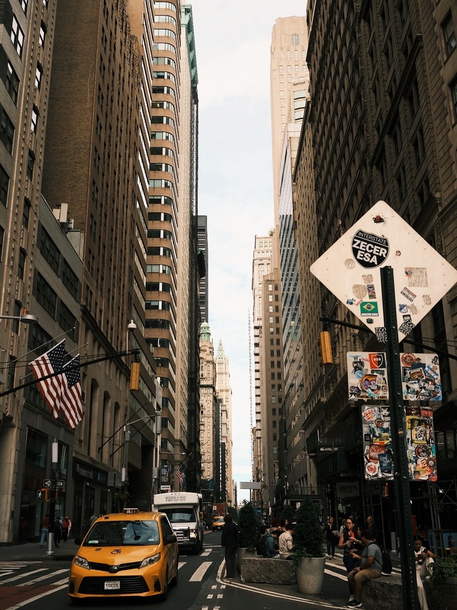
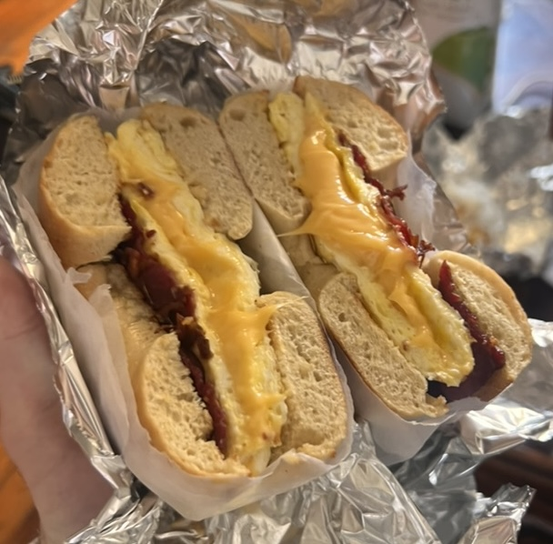
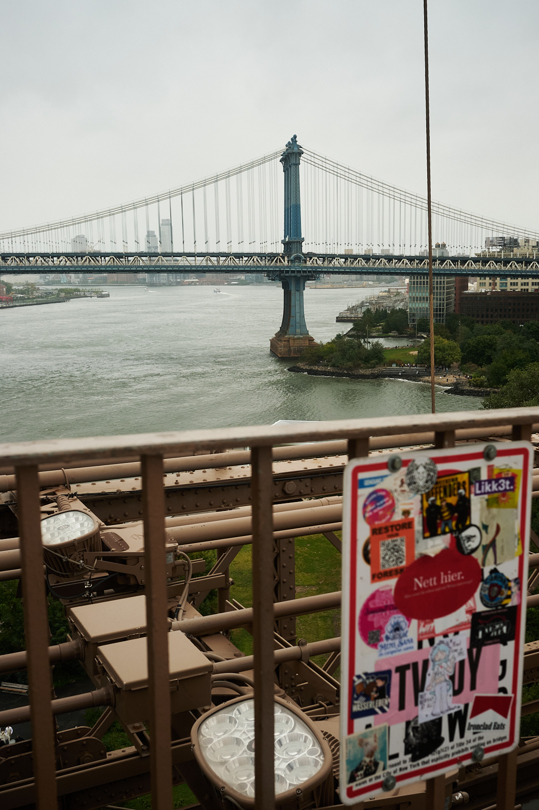
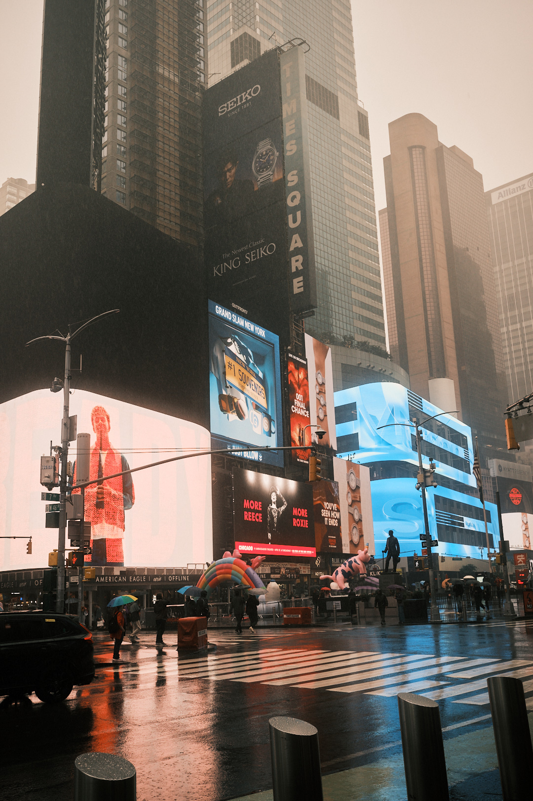

import AdSlot from '../../components/interactive/AdSlot.tsx';
import CharacterCreator from '../../components/interactive/CharacterCreator.tsx';
import PhotoGrid from '../../components/PhotoGrid.astro';
import BonusHeading from '../../components/BonusHeading.astro';
import Callout from '../../components/Callout.astro';
import redSoxWin from '../../assets/blog/londoner-in-nyc/red-sox-win.jpg';
import cocaCola from '../../assets/blog/londoner-in-nyc/coca-cola.jpg';
import brookline from '../../assets/blog/londoner-in-nyc/brookline.jpg';
import shakshuka from '../../assets/blog/londoner-in-nyc/sausage-shakshuka.jpg';
import redSoxB from '../../assets/blog/londoner-in-nyc/redsox-b.svg';

I've always wanted to visit New York, like an itch you just can't help but scratch. Growing up, The City was ever-present in media: movies, music, commercials, magazines, you name it. Luckily for me, a friend of a friend had a spare bedroom in Manhattan (where rent is notoriously extortionately expensive), and without a second thought, I seized the opportunity to crash.

I landed at JFK and boarded the busiest rapid transit system in the Western Hemisphere, aka the subway, making my way to the polarising FiDi, an overstimulating beginning to say the least. Bustling crowds of people all in a rush to be somewhere, a constant flurry of noise coming from every direction and the amalgamation of exhaust fumes, steam vents and street food carts.

Once I dropped my luggage off, all I can remember is the warm, alluring smell and subsequent taste of my first baconeggandcheese at the local deli.

This was my first reference point and I couldn't help but draw parallels to London (what some New Yorkers refer to as Old York) throughout. Why don't we have delis back home? Our uninspiring version is... Pret? Corner shops (with the weakest selection of sandwiches in existence, FYI)? Or, worst of all, a greasy spoon?

## The land of the ~~free~~ ads

Manhattan is home to towering skyscrapers surrounding you everywhere you look. The sheer scale of everything in NY is huge. I'm talking decked-out soccer mom SUVs (yes, I spelt it the American way), super wide roads and ginormous handheld water bottles. I'm talking a whopping 101.4 fl oz water bottle, or in other words 3L (shoutout to Poland Spring for keeping me hydrated after every chopped cheese).

Size aside, everything is uniquely monetised. Want a sticker to support a cause, or just 'cause it looks cool? That'll be $5 (don't forget the ~8.9% tax AND tips). Though judging by the sheer number of mailboxes and bins smothered in stickers, it seems like New Yorkers are accustomed to the hefty prices. Care to give a 20, 25, or 30% tip while the worker on the other side of the card machine silently judges you as you press the no-tip button? Tourists get a free pass (I hope).

During my first weekend I found myself at a vibrant Brooklyn block party where I bumped into a fellow techie. With a decade of experience under his belt, he took the leap of faith and started his own company. His goal was simple: help businesses gain more visibility and traction within AI search results.

This is known as AEO (answer engine optimisation). The idea is to reverse engineer the process of appearing in these answers by running hundreds of prompt experiments, recording the cited sources and optimising the content for a higher probability of appearing in the next search.

To think I was just getting used to the inescapable epilepsy-inducing adverts all over the city. Now I was learning that there's a whole new place to insert them...

We first saw the sponsored approach when OpenAI started injecting ads into our conversations at the beginning of 2026. Some companies were over the moon to finally bid for ad space within our chats. Others were content with paying for an advertising back door.

During that conversation it hit me: New York is the ultra-capitalist's wet dream. At one end you have the NYSE and Nasdaq (the capital behind the billboards), handling unfathomable sums of money on a daily basis paired with private mega-developments such as [Hudson Yards](https://www.theguardian.com/commentisfree/2019/mar/13/new-york-hudson-yards-ultra-capitalist). Funnily enough, Canary Wharf was heavily inspired by the World Financial Center in Battery Park City, not to mention they were both built by the same developer, Olympia & York.

On every morning subway ride I'd notice the hedge fund managers in their Patagonia vests with their morning espresso, plugged into their infinite digital news feed. In the same carriage, I saw the other extreme: the workers who sustain the city's economy barely holding their eyes open ahead of another long shift.

## The people

In my limited experience, I'm still convinced that NYC has the greatest density of interesting individuals. For starters, their fashion sense is... in the nicest way possible: everyone looks like a custom character created in your favourite video game. Just imagine a pair of distressed yellow Timberland boots but with green dried-out moss growing out from the toe part of the boot or graffiti-spray-painted blank tees with an upcoming underground clothing brand's logo, accessories which I didn't think could be accessories (umbrellas, extravagant paper fans, briefcases paired with tracksuits). Things I haven't seen anywhere in London. Shoreditch is the only notable comparison I can think of.

<CharacterCreator client:visible />

Once I got past the eccentric dress sense, the people were super friendly, charismatic and real. Each person I met had their own unique come-up story and I could easily spend hours talking to any given stranger I bump into (results may vary).

Across the Atlantic, London can feel cold at times. Boss man keeps doomscrolling reels on his phone on full volume as you enter your local corner shop. Greeting you is the last thing on his mind.

## “I'm from the Bronx, ya heard”

New Yorkers have a real sense of community and belonging. They're unfailingly proud to be from The City; they're true diehard supporters of all their favourite sports teams whatever their record (the Knicks just ended a 53-year wait for a championship this June). The loyalty doesn't stop at sports: being from a particular borough is a badge of honour. There's a distinct NYC pride which you might not find elsewhere: loud, direct, fast-paced. It's embodied in their everyday attire with ubiquitous 30-years-of-service tees, NYC merch and Yankees caps.

By contrast, Londoners' personality traits include: ALWAYS complaining about the weather, regardless of whether it's pouring rain or we're in the middle of a record-breaking heatwave; the tube, another riveting bonding topic; and the monotonically increasing cost of living. The London attitude is characterised by an understated, polite approach and strong scepticism towards overt displays of patriotism, with hardly anyone proclaiming they're a proud Londoner. Yet these shouldn't be confused with a lack of affection for the city. In fact, strangely, it might just be how we express it.

## What I learned about myself

I'm usually quite introverted, yet in the city that never sleeps it was hard to find a moment when I wasn't in conversation with complete strangers.

I've never been a fan of networking; it all seems a bit fake until someone (that person is usually me) says something so unhinged that it allows everyone to breathe a sigh of relief. The real dialogue can finally begin when everyone is disarmed of their professional persona. A conversation without an expectation to gain something is another level of refreshing.

I should really start a whole lot more conversations with strangers.

<BonusHeading initial={redSoxB} initialAlt="B">ONUS</BonusHeading>

I was also fortunate enough to visit Boston for just over 24 hours to watch an MLB game between the Red Sox and the Cubs. Almost immediately upon arriving, my first thought was: "Wow, this is a cleaner, family-friendly version of NY."

<Callout label="Disclaimer">

If you're expecting a baseball game to be action-packed and unlike anything you've ever seen before, prepare to be disappointed. It's in the top two most boring sports (and it's not number two) with constant DJ music breaks every 180 seconds coupled with ad breaks at every given opportunity. The next batter is doing a few practice swings? REEL UP THE [INSERT GAMBLING AD HERE] for the 150th time this evening.

</Callout>

<AdSlot client:visible />

<PhotoGrid photos={[
  { src: redSoxWin, alt: 'Fenway scoreboard reading Bank of America, Red Sox win' },
  { src: cocaCola, alt: 'The Coca-Cola sign above the stands at Fenway Park at night' },
]} />

Every sign is also plastered with ads, whether it's the scoreboard or a standalone mini billboard. As the Red Sox slugged to a 2–0 win, they couldn't help but have BANK OF AMERICA insert itself somehow, some way. The persistent nature of ads might just be an American thing after all and not solely confined to the Big Apple.

I found some peace in Cambridge, at a hole-in-the-wall, family-owned Middle Eastern lunch spot, Brookline Lunch, with an out-of-this-world sausage shakshuka. Shoutout to the owner, Jamal, who said he'd find me a nice Jordanian wife one day.

<PhotoGrid photos={[
  { src: brookline, alt: 'The hand-painted Brookline Lunch sign above the door' },
  { src: shakshuka, alt: 'A bowl of sausage shakshuka with feta and pitta' },
]} />
